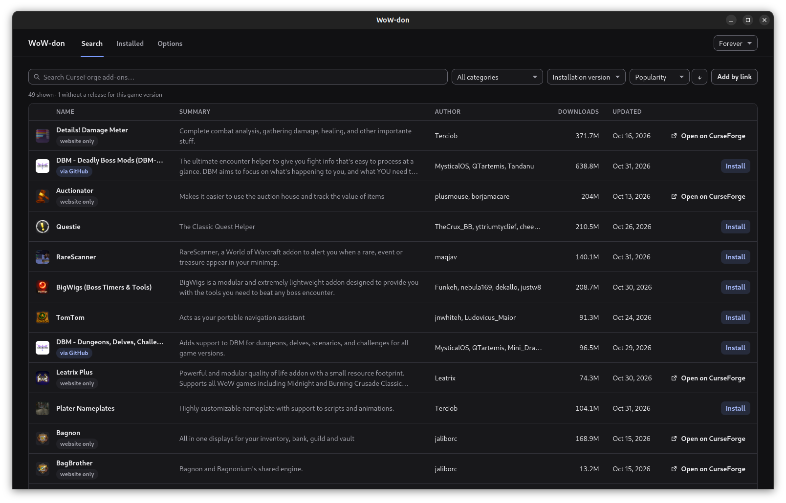
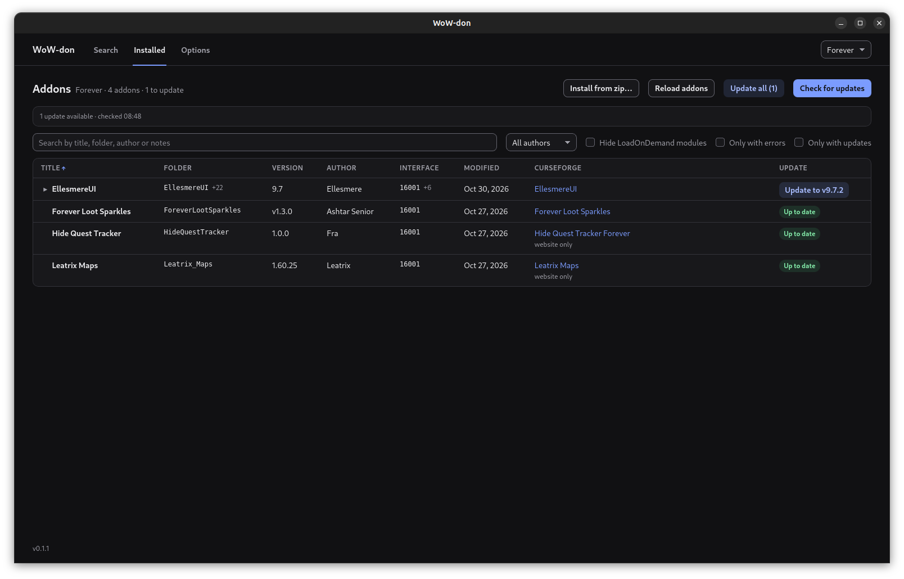

# WoW-don

A fast, open-source addon manager for World of Warcraft on **Linux, Windows and macOS**.
On Linux it works with the game inside a Wine prefix (Lutris, Bottles, Steam/Proton); on Windows
and macOS, with the normal installation of the native client.

**[Download the latest release](https://github.com/FabioSM46/wow-don/releases/latest)**

- **Find addons quickly.** Search the CurseForge catalogue, filter and sort both the catalogue
  and your installed addons.
- **Made for Wine as well.** Installations inside Wine prefixes are discovered for you, including
  several versions of the game in the same folder.
- **Native and lightweight.** A single Rust binary that uses the system webview, not Electron.

WoW-don is free software under the GPL. It has no ads and no account.





## Features

- Automatic discovery of WoW installations, which you confirm in Options, or adding them by hand.
- Your existing addons recognised through CurseForge fingerprints.
- Search with filters by category and game version, addon details with description and gallery,
  and required dependencies installed for you.
- Update one addon or all of them, reinstall, remove, or force the game version of an addon.
- Automatic updates: off, notify or install, on an interval you choose, with exclusions and an
  "Undo last auto-update".
- Other sources: Tukui, WoWInterface and GitHub Releases, plus zips dragged into the window.
- Export and import of your addon list as a text string.
- Backup of the `WTF` and `Interface` folders.
- Tray icon, close to tray and start with the system.
- Light and dark themes.

## Install

| System | Package | |
| --- | --- | --- |
| Debian, Ubuntu and derivatives | `.deb` | `sudo apt install ./wow-don_<version>_amd64.deb` |
| Windows 10 and 11 | `*-setup.exe` | See [the Windows warning](#windows-warning) |
| macOS (Apple Silicon and Intel) | `.dmg` | See [the macOS warning](#macos-warning) |

All packages are on the [releases page](https://github.com/FabioSM46/wow-don/releases/latest).

### Windows warning

The installer is not signed yet, so SmartScreen may say "Windows protected your PC". Press
**More info**, then **Run anyway**. You can read the [source](src-tauri/), and every package is
built by the public [release workflow](.github/workflows/release.yml), whose run you can inspect
from the Actions tab.

### macOS warning

Open the `.dmg` and drag WoW-don into Applications. The app is neither signed nor notarised,
so on the first launch macOS blocks it, saying it cannot verify the developer. To
open it the first time:

- in the Finder, in Applications, right-click (or Control-click) WoW-don and
  choose **Open**, then confirm with **Open** in the dialog;
- or, after the first blocked attempt, go to **System Settings → Privacy &
  Security** and, in the Security section, press **Open Anyway** next to the message about
  WoW-don.

You only need to do it once: from the following launches the app opens normally.

## Status

WoW-don is young: expect bugs. The plan is in
[docs/roadmap.md](docs/roadmap.md), and the project's background in
[docs/context.md](docs/context.md).

## Reporting a bug

[Open an issue](https://github.com/FabioSM46/wow-don/issues/new/choose) and choose **Report a
bug**. The form asks for what we need to reproduce the problem:

- the WoW-don version, shown in the bottom-left corner of the app;
- your system, how you run the game and the game version;
- what happened, with the exact error message;
- what should have happened;
- the shortest list of steps that makes it happen again.

Please write in English and open one issue per problem. Issues are public, so remove your
username from file paths and any personal data from logs and screenshots. For an idea, choose
**Suggest a feature**.

## Addon sources and the CurseForge API

The main source is the [CurseForge API](https://docs.curseforge.com/rest-api).
The API requires a key. WoW-don has a third-party application key from CurseForge, and it
never ships in the app: it lives only in the secrets of the
[wow-don-proxy](https://github.com/FabioSM46/wow-don-proxy) Cloudflare Worker, which answers a
closed list of read-only, World of Warcraft-only calls. The backend calls the proxy; zips are
downloaded straight from CurseForge's CDN (D44).

Rules the project follows:

- the key is never in the app, the repository, a build or a log;
- no scraping of the CurseForge site and no reuse of other apps' keys;
- addons with `allowModDistribution = false` are not downloaded automatically from CurseForge.

## Stack

| Part | Technology |
| --- | --- |
| Backend | Rust (edition 2024) |
| Desktop app | Tauri 2 |
| Frontend | React 19 + TypeScript, Vite |
| Package manager | pnpm |

The decisions and their reasons are in [docs/decisions.md](docs/decisions.md).

## Repository structure

```
wow-don/
├── src/                    # React frontend
│   ├── App.tsx
│   ├── App.css
│   └── main.tsx
├── src-tauri/              # Rust backend and Tauri configuration
│   ├── src/
│   │   ├── main.rs         # entry point
│   │   ├── lib.rs          # Tauri setup and command registration
│   │   ├── config.rs       # the CurseForge proxy address (D44)
│   │   └── commands.rs     # commands the frontend can invoke
│   ├── capabilities/       # Tauri window permissions
│   ├── icons/
│   ├── Cargo.toml
│   └── tauri.conf.json
├── docs/
│   ├── context.md          # idea, motivation, prior art, sources
│   ├── decisions.md        # decision log
│   ├── architecture.md     # modules, APIs used, security
│   └── roadmap.md          # milestones
├── scripts/                # pipeline helpers and automation tests
├── .github/                # CI, DeepSeek review, labeler, issue templates
├── .claude/skills/         # agent skills (/dev-issue, /process-pr, /scrum-master)
├── AGENTS.md               # rules for AI agents and the pipeline
├── index.html
├── package.json
└── vite.config.ts
```

The planned structure of the backend modules is in
[docs/architecture.md](docs/architecture.md).

## Development

### Requirements

| Tool | Version | Needed for |
| ----- | ------------------------------- | ------------------ |
| Rust  | pinned in `src-tauri/rust-toolchain.toml` (rustfmt + clippy) | backend |
| Node  | 22                              | frontend |
| pnpm  | 10                              | frontend |
| gh    | 2.18.0 or later                 | pipeline scripts |
| jq    | any recent one                  | pipeline scripts, `scripts/test/` |
| python3 | 3.12 recommended              | DeepSeek reviewer tests |

On **Windows** you need the Microsoft C++ Build Tools (the "Desktop development with C++"
workload) and WebView2, already present on Windows 10 and 11.

On **macOS** you need the Xcode command line tools (`xcode-select --install`);
WebKit is already part of the system.

On **Linux** you need the system libraries for Tauri. On Ubuntu/Debian:

  ```bash
  sudo apt install libwebkit2gtk-4.1-dev build-essential curl wget file \
    libxdo-dev libssl-dev libayatana-appindicator3-dev librsvg2-dev
  ```

### CurseForge

No key is needed, in development or in a release: the app reaches CurseForge through the
[wow-don-proxy](https://github.com/FabioSM46/wow-don-proxy) Worker, which holds the key (D44).
To test against a proxy run locally with `wrangler dev`, start a debug build with
`WOWDON_CURSEFORGE_PROXY=http://127.0.0.1:8787`; release builds accept only `https` there.

### Commands

```bash
pnpm install          # frontend dependencies
pnpm tauri dev        # starts the app in development with hot reload
pnpm tauri build      # release build and package for the current platform
```

`pnpm tauri build` produces the package for the platform it runs on: on Linux the
`.deb` (`wow-don_<version>_amd64.deb`) in `src-tauri/target/release/bundle/deb/`, on Windows the
`*-setup.exe` installer in `src-tauri/target/release/bundle/nsis/`, on macOS the `.dmg` in
`src-tauri/target/release/bundle/dmg/`. A Windows package is built on Windows
(or on the CI Windows runner) and a macOS one on macOS, not from Linux. The release's universal
`.dmg` is obtained with
`pnpm tauri build --target universal-apple-darwin --bundles dmg`, after adding the
`aarch64-apple-darwin` and `x86_64-apple-darwin` targets to the toolchain with `rustup target add`;
it ends up in `src-tauri/target/universal-apple-darwin/release/bundle/dmg/`.

Quick checks:

```bash
pnpm build                              # frontend type-check and build
pnpm test                               # frontend tests (node --test, Node 22.18 or later)
cargo check --manifest-path src-tauri/Cargo.toml
```

### Workflow

The integration branch is `develop` (the default branch); `main` receives only releases. Work
goes issue → PR against `develop` → CI and automated DeepSeek review → merge. The rules
for AI agents and the pipeline details are in [AGENTS.md](AGENTS.md).

## Release

A `v<version>` tag on a `main` commit starts `.github/workflows/release.yml`, which builds the `.deb`,
the Windows installer and the universal macOS `.dmg` and attaches them to a draft GitHub
release. The release is published by hand after checking it.

Every package contains `THIRD-PARTY-LICENSES`, with the licences of the crates and npm packages
compiled into the app. `scripts/third-party-licenses.py` writes it before every build, and the
`src-tauri/tauri.release*.conf.json` configuration puts it in the package: on Linux in
`/usr/share/doc/wow-don/` next to `copyright`, on Windows and macOS among the app's resources, together with `LICENSE`.

## Documentation

- [Context](docs/context.md)
- [Decisions](docs/decisions.md)
- [Architecture](docs/architecture.md)
- [Roadmap](docs/roadmap.md)

## Notes

World of Warcraft is a trademark of Blizzard Entertainment. WoW-don is an independent
project, neither affiliated with nor endorsed by Blizzard, CurseForge or Overwolf.

## Licence

WoW-don is free software, distributed under the [GNU General Public License v3.0 or
later](LICENSE) (`GPL-3.0-or-later`).
